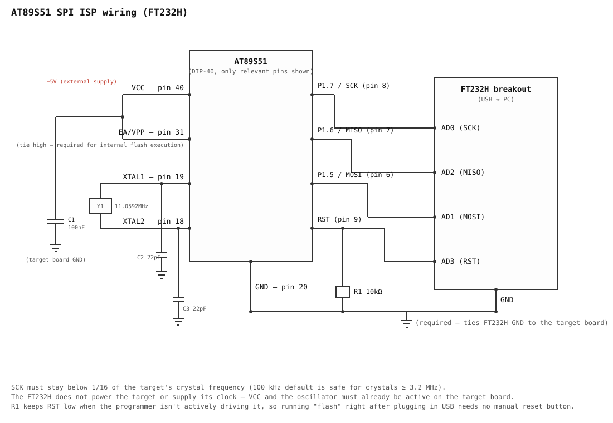
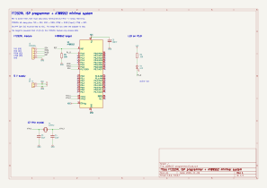

# at89s5x-isp

[繁體中文](README.zh-TW.md)

A command-line ISP programmer for the Atmel/Microchip **AT89S51** and
**AT89S52**, driven through a USB-to-serial/SPI adapter:

- **FT232RL / FT232R** (cheap UART bridge boards) — software SPI over
  bit-bang mode
- **FT232H** — hardware SPI over MPSSE (**untested on real hardware**)

## How it works

A step-by-step explanation with diagrams is in
[docs/how-it-works.md](docs/how-it-works.md)
([繁體中文](docs/how-it-works.zh-TW.md)).

The AT89S51 (unlike the STC 89 series) does not have a UART bootloader.
Instead it exposes an SPI-like serial programming interface: `RST`, `SCK`,
`MOSI`, `MISO`. Programming is done by holding `RST` high and clocking a
fixed instruction set (Programming Enable, Chip Erase, Read/Write Program
Memory, Read Signature Byte) into the part — see `src/isp.rs` for the exact
byte sequences, taken from the Microchip datasheets (not included in this
repository) for the
[AT89S51](https://www.microchip.com/en-us/product/AT89S51) and
[AT89S52](https://www.microchip.com/en-us/product/AT89S52) ("Serial Programming
Instruction Set").

Two hardware requirements that are easy to miss:

- **The target needs its own running crystal/oscillator.** The ISP shift
  register is clocked internally off `XTAL1`; the adapter does not supply a
  clock signal.
- **SCK must stay below 1/16 of the target's crystal frequency.** The
  default `--clock-hz 100000` is conservative and safe for any crystal
  ≥ 3.2 MHz; lower it if you're using a slower crystal.

## Comparison with other approaches

| Approach | Adapter firmware | Host software | Notes |
|----------|------------------|---------------|-------|
| This project (FT232RL / FT232H) | None | Single Rust binary | Linux, Windows, macOS |
| Arduino as ISP | Sketch must be flashed first | avrdude or a custom tool | |
| USBasp-style | Custom firmware | avrdude-compatible | |
| Parallel port | None | Linux-only tools | Parallel ports are rare on current PCs |

## Installation

### 1. Build tools and libraries

```sh
# Rust toolchain (https://rustup.rs), then on Debian/Ubuntu:
sudo apt install build-essential pkg-config libusb-1.0-0-dev
```

### 2. Build

```sh
git clone https://github.com/single9/at89s5x-programmer.git && cd at89s5x-programmer
cargo build --release          # binary: target/release/at89s5x-isp
```

### 3. Linux USB permissions

The FT232R backend uses libusb. It detaches the kernel's `ftdi_sio` driver
automatically while the tool runs and hands it back afterwards, so you do
**not** need `rmmod`, and `/dev/ttyUSB*` keeps working the rest of the time.
It only needs permission to open the USB device:

```sh
./scripts/setup-linux.sh
```

The script checks for libusb, adds your user to the `plugdev` group, and
installs a udev rule. Then **unplug and re-plug the adapter** (and log out
and back in if you were just added to `plugdev`). It is safe to re-run.

Manual equivalent:

```sh
echo 'SUBSYSTEM=="usb", ATTR{idVendor}=="0403", ATTR{idProduct}=="6001", GROUP="plugdev", MODE="0660"' \
  | sudo tee /etc/udev/rules.d/99-ft232r.rules
sudo udevadm control --reload-rules && sudo udevadm trigger
```

The rule is permanent; other computers need the same one-time setup.

### 4. Windows

Windows is supported for the FT232R path (verified with an FT232RL). Use the
`.zip` from the releases page, or build from source with the MSVC toolchain.
The `.exe` has no extra runtime requirements.

1. Install the **WinUSB** driver for the adapter with
   [Zadig](https://zadig.akeo.ie/): select the FT232R, choose WinUSB, and
   install.
2. Run `at89s5x-isp.exe info` from a terminal.

While WinUSB is bound, the adapter no longer appears as a COM port. To use it
as a serial port again, reinstall FTDI's driver in Device Manager.

### 5. macOS

macOS is supported for the FT232R path (verified with an FT232RL). The release
contains one universal binary that runs on both Intel and Apple Silicon, with
libusb built in, so nothing else needs to be installed.

```sh
tar xzf at89s5x-isp-*-macos-universal.tar.gz && cd at89s5x-isp-*-macos-universal
xattr -d com.apple.quarantine at89s5x-isp   # required once, see below
./at89s5x-isp info
```

The binary is not notarized, so macOS blocks it when it was downloaded with a
browser (verified). The `xattr` command removes the quarantine flag that the
browser added; it is harmless if the flag is not present.

If opening the adapter fails with an access error, the system's FTDI driver
may own the device; try running with `sudo`.

## Wiring

### Adapter → AT89S51/S52 (DIP-40)



Both adapters use the same wiring; only the adapter-side pin names differ.

| Signal | AT89S5x pin | FT232RL (bit-bang) | FT232H (MPSSE, untested) |
|--------|-------------|--------------------|--------------------------|
| SCK    | 8 (P1.7)    | TXD (D0)           | AD0 |
| MOSI   | 6 (P1.5)    | RXD (D1)           | AD1 |
| MISO   | 7 (P1.6)    | RTS# (D2), input   | AD2 |
| RST    | 9 (with R1, see below) | CTS# (D3) | AD3 |
| GND    | 20          | GND                | GND |

Set the board's VCCIO/jumper to the target's supply voltage (3.3 V or 5 V)
so the logic levels match. Counterfeit FT232RL chips may misbehave in
bit-bang mode. The FT232H path has not been tested on real hardware; only
the FT232RL path has been verified.

### Target circuit



The adapter does not drive these; they must already be on the target board:

- `VCC` (pin 40) powered, `GND` (pin 20) shared with the adapter
- `EA/VPP` (pin 31) tied to `+5V` so the CPU executes from internal flash
- A crystal (e.g. 11.0592 MHz) with two ~22 pF load caps on `XTAL1`/`XTAL2`
  (pins 19/18), running
- A decoupling cap across `VCC`/`GND`
- **C6: a 10 µF capacitor from VCC to RST** (with R1 it forms a power-on reset),
  needed when the target runs on its own without the programmer attached.
  It is optional while programming, because the adapter overrides it.
- **R1: a 10 kΩ resistor from RST to GND**, so RST has a defined level
  whenever the adapter isn't actively driving it (before the programmer
  opens the device, or if it's unplugged). Without it RST would float and
  could spuriously reset the target. The adapter drives RST push-pull, so it
  overrides the weak pull-down without conflict.

### No manual reset button

Entering ISP mode doesn't require a button: `enter_programming_mode()`
(`src/isp.rs`) drives RST directly, so running `flash` right after plugging
in the adapter is enough — the pulse/enable sequence happens automatically
every time.

## Usage

The adapter (FT232RL or FT232H) is detected automatically from its USB ID.
Pass `--adapter ft232r` or `--adapter ft232h` only to override it, e.g. when
both are plugged in.

```sh
# Identify the chip (reads the 3 signature bytes)
cargo run -- info

# Erase, write, and verify a HEX file (erase + verify are on by default)
cargo run -- flash firmware.hex

# Just erase
cargo run -- erase

# Verify flash contents against a HEX file without writing
cargo run -- verify firmware.hex

# Select a specific adapter by serial number, and a slower clock
cargo run -- --serial A1B2C3D4 --clock-hz 50000 flash firmware.hex
```

Speed: `verify` reads about 8 KB in 12 s at the default 100 kHz and in about
2.4 s at `--clock-hz 700000`. SCK may go up to crystal / 16, so with a 12 MHz
crystal 700000 is the practical maximum. `flash` only reads back the bytes it
wrote, so small programs finish in under a second.

Diagnostic commands (no flash is touched):

```sh
# MOSI jumpered to MISO, no target needed: checks the adapter's SPI timing
cargo run -- selftest

# Hold RST high and send Programming Enable every 50 ms, printing replies
cargo run -- probe --seconds 30

# Hold RST high/low for N seconds, to measure pin 9 with a multimeter
cargo run -- rst high --seconds 20
```

Set `AT89S5X_ISP_TRACE=1` to print the pin states read back when RST changes.

A good first check is `info`. It should print the adapter and a device line
such as:

```
Adapter   FT232R (bit-bang), SCK 100 kHz
Device    AT89S52  signature 1E 52 06  8 KB flash
```

`target did not answer Programming Enable` means the wiring, power, or the
target's crystal needs checking (see Troubleshooting).

## Example

`examples/blink_p1_0.hex` blinks an LED on P1.0 (pin 1) at about 2 Hz with a
12 MHz crystal; `examples/blink_p1_0.asm` is its source. Wire the LED
active-low (VCC, resistor, LED, P1.0), then:

```sh
cargo run -- flash examples/blink_p1_0.hex
```

Verified on a real AT89S52. RST must read low afterwards (R1 to GND) or the
program will not run.

## Troubleshooting

`target did not answer Programming Enable` with reply `FF FF FF FF`, or
replies that keep changing, means the target is not synchronising:

1. Run `selftest` with MOSI jumpered to MISO. If it passes, the adapter is fine.
2. Check the target crystal really oscillates (XTAL2, pin 18, about 2 V; 0 V or
   5 V means it is not running) and has a 22–30 pF cap from each crystal pin to GND.
3. Check VCC/GND decoupling (0.1 µF), EA/VPP (pin 31) at VCC, and keep wires short.
4. Remove other loads from P1.5–P1.7 (LEDs, buttons) and, as a test, C6 on RST.
5. Try a slower clock, e.g. `--clock-hz 5000`.

A 12 MHz crystal is fine: SCK only has to stay below crystal / 16 (750 kHz).

## Notes / limitations

- Blank (`0xFF`) bytes are skipped when writing, since erased flash is already `0xFF`.
- The chip is auto-detected from its signature bytes (AT89S51 = `1E 51 06`,
  AT89S52 = `1E 52 06`) and the flash size (4 KB / 8 KB) is chosen to match.
  An unrecognised signature falls back to 4 KB with a warning.
- Lock bits are not currently read/written — only flash contents.
- FT232H only: it uses the D2XX driver (`libftd2xx`), which on Linux cannot
  open a device the kernel's `ftdi_sio` has claimed; unbind it or use
  `libftd2xx`'s supplied udev rules first.

## License

[MIT](LICENSE).
