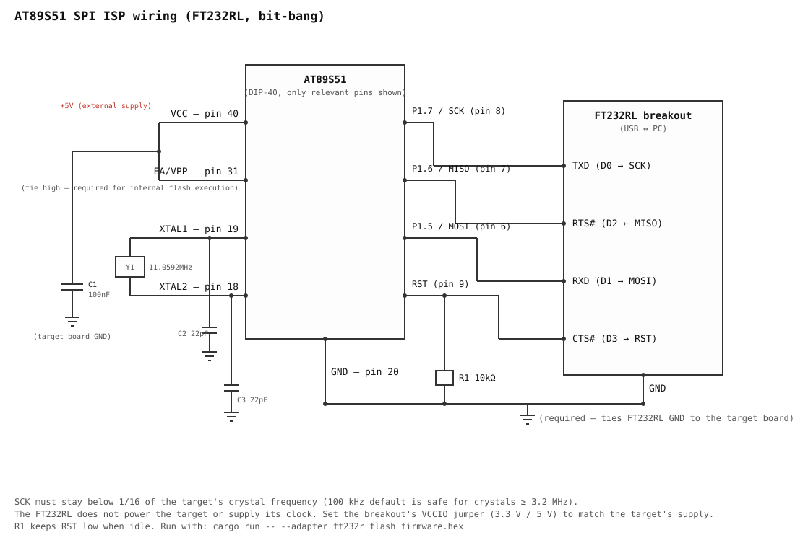

# at89s51-isp

A command-line ISP programmer for the Atmel/Microchip **AT89S51** and
**AT89S52**, driven through a USB-to-serial/SPI adapter:

- **FT232RL / FT232R** (cheap UART bridge boards) — software SPI over
  bit-bang mode, `--adapter ft232r`
- **FT232H** — hardware SPI over MPSSE, `--adapter ft232h` (default)

## How it works

The AT89S51 (unlike the STC 89 series) does not have a UART bootloader.
Instead it exposes an SPI-like serial programming interface: `RST`, `SCK`,
`MOSI`, `MISO`. Programming is done by holding `RST` high and clocking a
fixed instruction set (Programming Enable, Chip Erase, Read/Write Program
Memory, Read Signature Byte) into the part — see `src/isp.rs` for the exact
byte sequences, taken from the datasheets in `docs/datasheet/`.

Two hardware requirements that are easy to miss:

- **The target needs its own running crystal/oscillator.** The ISP shift
  register is clocked internally off `XTAL1`; the adapter does not supply a
  clock signal.
- **SCK must stay below 1/16 of the target's crystal frequency.** The
  default `--clock-hz 100000` is conservative and safe for any crystal
  ≥ 3.2 MHz; lower it if you're using a slower crystal.

## Installation

### 1. Build tools and libraries

```sh
# Rust toolchain (https://rustup.rs), then on Debian/Ubuntu:
sudo apt install build-essential pkg-config libusb-1.0-0-dev
```

### 2. Build

```sh
git clone https://github.com/single9/8051-programmer.git && cd 8051-programmer
cargo build --release          # binary: target/release/at89s51-isp
```

### 3. Linux USB permissions (FT232R, one time per computer)

The FT232R backend uses libusb. It detaches the kernel's `ftdi_sio` driver
automatically while the tool runs and hands it back afterwards, so you do
**not** need `rmmod`, and `/dev/ttyUSB*` keeps working the rest of the time.
It only needs permission to open the USB device:

```sh
./scripts/setup-linux.sh
```

The script checks for libusb, adds your user to the `plugdev` group, and
installs a udev rule. Then **unplug and re-plug the adapter** (and log out
and back in if you were just added to `plugdev`). It is safe to re-run.

Manual equivalent:

```sh
echo 'SUBSYSTEM=="usb", ATTR{idVendor}=="0403", ATTR{idProduct}=="6001", GROUP="plugdev", MODE="0660"' \
  | sudo tee /etc/udev/rules.d/99-ft232r.rules
sudo udevadm control --reload-rules && sudo udevadm trigger
```

The rule is permanent; other computers need the same one-time setup.
Windows needs the WinUSB driver (e.g. via Zadig), which stops the adapter
working as a COM port; Windows and macOS are untested.

## Wiring

### FT232RL → AT89S51 (DIP-40)



| FT232RL pin | Bit-bang | AT89S51 pin | Function |
|-------------|----------|-------------|----------|
| TXD         | D0       | 8           | SCK (P1.7) |
| RXD         | D1       | 6           | MOSI (P1.5) |
| RTS#        | D2       | 7           | MISO (P1.6), input |
| CTS#        | D3       | 9           | RST (with R1, see below) |
| GND         |          | 20          | GND |

Set the board's VCCIO/jumper to the target's supply voltage (3.3 V or 5 V)
so the logic levels match. Counterfeit FT232RL chips may misbehave in
bit-bang mode.

### FT232H → AT89S51 (DIP-40)


| FT232H | AT89S51 pin | Function |
|--------|-------------|----------|
| AD0    | 8           | SCK (P1.7) |
| AD1    | 6           | MOSI (P1.5) |
| AD2    | 7           | MISO (P1.6) |
| AD3    | 9           | RST (with R1, see below) |
| GND    | 20          | GND |

### Target circuit (both adapters)

The adapter does not drive these; they must already be on the target board:

- `VCC` (pin 40) powered, `GND` (pin 20) shared with the adapter
- `EA/VPP` (pin 31) tied to `+5V` so the CPU executes from internal flash
- A crystal (e.g. 11.0592 MHz) with two ~22 pF load caps on `XTAL1`/`XTAL2`
  (pins 19/18), running
- A decoupling cap across `VCC`/`GND`
- **R1: a 10 kΩ resistor from RST to GND**, so RST has a defined level
  whenever the adapter isn't actively driving it (before the programmer
  opens the device, or if it's unplugged). Without it RST would float and
  could spuriously reset the target. The adapter drives RST push-pull, so it
  overrides the weak pull-down without conflict.

### No manual reset button

Entering ISP mode doesn't require a button: `enter_programming_mode()`
(`src/isp.rs`) drives RST directly, so running `flash` right after plugging
in the adapter is enough — the pulse/enable sequence happens automatically
every time.

## Usage

Add `--adapter ft232r` to every command when using an FT232RL.

```sh
# Identify the chip (reads the 3 signature bytes)
cargo run -- --adapter ft232r info

# Erase, write, and verify a HEX file (erase + verify are on by default)
cargo run -- --adapter ft232r flash firmware.hex

# Just erase
cargo run -- --adapter ft232r erase

# Verify flash contents against a HEX file without writing
cargo run -- --adapter ft232r verify firmware.hex

# Select a specific adapter by serial number, and a slower clock
cargo run -- --adapter ft232r --serial A1B2C3D4 --clock-hz 50000 flash firmware.hex
```

Diagnostic commands (no flash is touched):

```sh
# MOSI jumpered to MISO, no target needed: checks the adapter's SPI timing
cargo run -- --adapter ft232r selftest

# Hold RST high and send Programming Enable every 50 ms, printing replies
cargo run -- --adapter ft232r probe --seconds 30

# Hold RST high/low for N seconds, to measure pin 9 with a multimeter
cargo run -- --adapter ft232r rst high --seconds 20
```

Set `AT89S51_ISP_TRACE=1` to print the pin states read back when RST changes.

A good first check is `info`: it should print `Signature: 1E 51 06 (AT89S51)`
or `1E 52 06 (AT89S52)`. `Programming Enable failed` means wiring, power, or
the target's crystal needs checking.

## Example

`examples/blink_p1_0.hex` blinks an LED on P1.0 (pin 1) at about 2 Hz with a
12 MHz crystal; `examples/blink_p1_0.asm` is its source. Wire the LED
active-low (VCC, resistor, LED, P1.0), then:

```sh
cargo run -- --adapter ft232r flash examples/blink_p1_0.hex
```

Verified on a real AT89S52. RST must read low afterwards (R1 to GND) or the
program will not run.

## Troubleshooting

`Programming Enable failed` with reply `FF FF FF FF`, or replies that keep
changing, means the target is not synchronising:

1. Run `selftest` with MOSI jumpered to MISO. If it passes, the adapter is fine.
2. Check the target crystal really oscillates (XTAL2, pin 18, about 2 V; 0 V or
   5 V means it is not running) and has a 22–30 pF cap from each crystal pin to GND.
3. Check VCC/GND decoupling (0.1 µF), EA/VPP (pin 31) at VCC, and keep wires short.
4. Remove other loads from P1.5–P1.7 (LEDs, buttons) and RST (RC reset circuit).
5. Try a slower clock, e.g. `--clock-hz 5000`.

A 12 MHz crystal is fine: SCK only has to stay below crystal / 16 (750 kHz).

## Notes / limitations

- Blank (`0xFF`) bytes are skipped when writing, since erased flash is already `0xFF`.

- The chip is auto-detected from its signature bytes (AT89S51 = `1E 51 06`,
  AT89S52 = `1E 52 06`) and the flash size (4 KB / 8 KB) is chosen to match.
  An unrecognised signature falls back to 4 KB with a warning.
- Lock bits are not currently read/written — only flash contents.
- FT232H only: it uses the D2XX driver (`libftd2xx`), which on Linux cannot
  open a device the kernel's `ftdi_sio` has claimed; unbind it or use
  `libftd2xx`'s supplied udev rules first.
