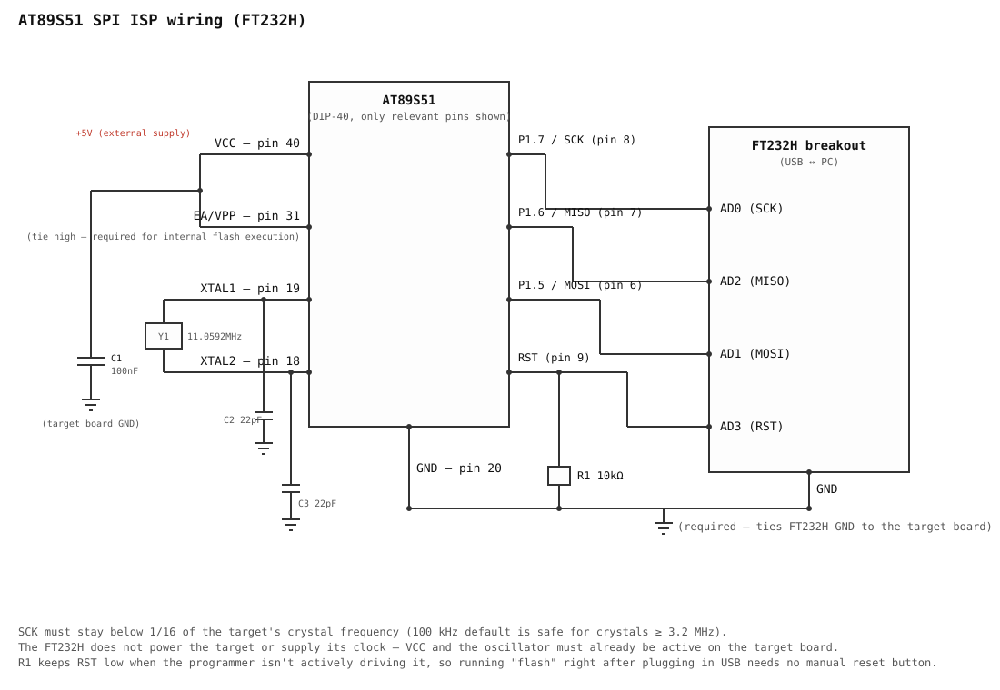
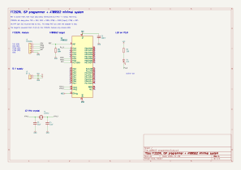

# at89s5x-isp

[English](README.md)

Atmel / Microchip **AT89S51** 與 **AT89S52** 的命令列 ISP 燒錄工具，透過 USB 轉序列埠 / SPI 轉接器進行燒錄：

- **FT232RL / FT232R** (便宜的 UART 橋接模組)：以 bit-bang 模式實作軟體 SPI
- **FT232H**：以 MPSSE 提供硬體 SPI (**尚未在實體硬體上測試**)

## 運作原理

附圖的逐步說明請見 [docs/how-it-works.zh-TW.md](docs/how-it-works.zh-TW.md) ([English](docs/how-it-works.md))。

AT89S51 與 STC 89 系列不同，沒有 UART 啟動載入程式 (bootloader)，而是提供類似 SPI 的序列燒錄介面：`RST`、`SCK`、`MOSI`、`MISO`。燒錄時先將 `RST` 拉高，再依序送入固定的指令集 (Programming Enable、Chip Erase、讀寫程式記憶體、讀取簽名位元組)。確切的位元組序列請見 `src/isp.rs`，內容取自 Microchip 的 [AT89S51](https://www.microchip.com/en-us/product/AT89S51) 與 [AT89S52](https://www.microchip.com/en-us/product/AT89S52) 資料手冊 ("Serial Programming Instruction Set")。

兩項容易忽略的硬體需求：

- **目標板必須有自己的晶體振盪器且正在運作。** ISP 移位暫存器由 `XTAL1` 在內部提供時脈，轉接器不會提供時脈訊號。
- **SCK 必須低於目標板晶體頻率的 1/16。** 預設的 `--clock-hz 100000` 相當保守，適用於任何 ≥ 3.2 MHz 的晶體；若使用較慢的晶體，請調低此值。

## 安裝

### 1. 編譯工具與函式庫

```sh
# 先安裝 Rust 工具鏈 (https://rustup.rs)，在 Debian / Ubuntu 上再執行：
sudo apt install build-essential pkg-config libusb-1.0-0-dev
```

### 2. 編譯

```sh
git clone https://github.com/single9/at89s5x-programmer.git && cd at89s5x-programmer
cargo build --release          # 執行檔：target/release/at89s5x-isp
```

### 3. Linux 的 USB 權限 (FT232R，每台電腦設定一次)

FT232R 後端使用 libusb。程式執行期間會自動分離核心的 `ftdi_sio` 驅動程式，結束後再歸還，因此**不需要** `rmmod`，`/dev/ttyUSB*` 平時也能照常使用。只需要取得開啟 USB 裝置的權限：

```sh
./scripts/setup-linux.sh
```

此腳本會檢查 libusb、將使用者加入 `plugdev` 群組，並安裝 udev 規則。完成後請**重新拔插轉接器** (若剛被加入 `plugdev`，還需登出再登入)。腳本可以重複執行。

手動設定的做法：

```sh
echo 'SUBSYSTEM=="usb", ATTR{idVendor}=="0403", ATTR{idProduct}=="6001", GROUP="plugdev", MODE="0660"' \
  | sudo tee /etc/udev/rules.d/99-ft232r.rules
sudo udevadm control --reload-rules && sudo udevadm trigger
```

此規則為永久設定；其他電腦需各自做一次相同的設定。Windows 需要 WinUSB 驅動程式 (例如透過 Zadig)，安裝後轉接器就不能再當作 COM 埠使用。Windows 與 macOS 均未測試。

## 接線

### 轉接器 → AT89S51/S52 (DIP-40)



兩種轉接器的接法相同，只有轉接器端的接腳名稱不同。

| 訊號 | AT89S5x 接腳 | FT232RL (bit-bang) | FT232H (MPSSE，未測試) |
|------|--------------|--------------------|------------------------|
| SCK  | 8 (P1.7)     | TXD (D0)           | AD0 |
| MOSI | 6 (P1.5)     | RXD (D1)           | AD1 |
| MISO | 7 (P1.6)     | RTS# (D2)，輸入    | AD2 |
| RST  | 9 (搭配 R1，見下方) | CTS# (D3)   | AD3 |
| GND  | 20           | GND                | GND |

請將模組的 VCCIO 或跳線設定為目標板的供電電壓 (3.3 V 或 5 V)，使邏輯準位一致。仿冒的 FT232RL 晶片在 bit-bang 模式下可能無法正常運作。FT232H 路徑尚未在實體硬體上測試，僅 FT232RL 路徑已驗證。

### 目標板電路 (兩種轉接器皆適用)



以下部分不由轉接器提供，必須已存在於目標板上：

- `VCC` (pin 40) 已供電，`GND` (pin 20) 與轉接器共地
- `EA/VPP` (pin 31) 接 `+5V`，使 CPU 從內部 Flash 執行
- 晶體振盪器 (例如 11.0592 MHz) 搭配兩顆約 22 pF 的負載電容，接在 `XTAL1` / `XTAL2` (pin 19 / 18)，且正在運作
- 跨接在 `VCC` / `GND` 之間的去耦電容
- **C6：10 µF 電容，接在 VCC 與 RST 之間** (與 R1 構成上電重置)。目標板脫離燒錄器獨立運作時需要；燒錄期間為選用，因為轉接器的驅動會蓋過它。
- **R1：10 kΩ 電阻，接在 RST 與 GND 之間**，使轉接器未驅動 RST 時 (程式開啟裝置之前，或轉接器被拔除時) RST 仍有確定的準位。沒有它，RST 會浮接，可能讓目標板被誤重置。轉接器以推挽方式驅動 RST，可直接蓋過這個弱下拉，不會衝突。

### 不需要手動重置按鈕

進入 ISP 模式不需要按鈕：`enter_programming_mode()` (`src/isp.rs`) 會直接驅動 RST，所以插上轉接器後直接執行 `flash` 即可，脈衝與啟用程序每次都會自動完成。

## 使用方式

轉接器 (FT232RL 或 FT232H) 會依 USB ID 自動偵測。只有需要覆寫時才加上 `--adapter ft232r` 或 `--adapter ft232h`，例如兩種轉接器同時插著的時候。

```sh
# 辨識晶片 (讀取 3 個簽名位元組)
cargo run -- info

# 抹除、寫入並驗證 HEX 檔 (預設會抹除與驗證)
cargo run -- flash firmware.hex

# 只抹除
cargo run -- erase

# 不寫入，只將 Flash 內容與 HEX 檔比對
cargo run -- verify firmware.hex

# 依序號指定轉接器，並使用較慢的時脈
cargo run -- --serial A1B2C3D4 --clock-hz 50000 flash firmware.hex
```

速度：`verify` 在預設的 100 kHz 下讀取約 8 KB 需 12 秒，在 `--clock-hz 700000` 下約需 2.4 秒。SCK 最高可到晶體頻率 / 16，所以使用 12 MHz 晶體時，700000 是實用上限。`flash` 只讀回自己寫入的位元組，因此小型程式不到一秒即可完成。

診斷指令 (不會更動 Flash)：

```sh
# MOSI 與 MISO 以導線短路，不需目標晶片：檢查轉接器的 SPI 時序
cargo run -- selftest

# 將 RST 拉高，每 50 ms 送一次 Programming Enable，並印出回覆
cargo run -- probe --seconds 30

# 將 RST 固定在高或低 N 秒，以便用三用電表量測 pin 9
cargo run -- rst high --seconds 20
```

設定 `AT89S5X_ISP_TRACE=1`，可在 RST 改變時印出讀回的接腳狀態。

建議先執行 `info` 做第一個檢查。正常會印出轉接器與裝置資訊，例如：

```
Adapter   FT232R (bit-bang), SCK 100 kHz
Device    AT89S52  signature 1E 52 06  8 KB flash
```

若出現 `target did not answer Programming Enable`，代表需要檢查接線、電源，或目標板的晶體振盪器 (見疑難排解)。

## 範例

`examples/blink_p1_0.hex` 會讓 P1.0 (pin 1) 上的 LED 閃爍，12 MHz 晶體下約 2 Hz；`examples/blink_p1_0.asm` 是其原始碼。請將 LED 接成低電位點亮 (VCC、電阻、LED、P1.0)，然後執行：

```sh
cargo run -- flash examples/blink_p1_0.hex
```

已在實際的 AT89S52 上驗證。燒錄完成後 RST 必須為低電位 (R1 接地)，程式才會執行。

## 疑難排解

若出現 `target did not answer Programming Enable`，且回覆為 `FF FF FF FF`，或回覆一直變動，代表目標板沒有正常同步：

1. 將 MOSI 與 MISO 短路後執行 `selftest`。若通過，代表轉接器沒有問題。
2. 確認目標板的晶體振盪器確實在振盪 (XTAL2，pin 18，約 2 V；0 V 或 5 V 代表沒有運作)，且兩支晶體腳各有一顆 22 到 30 pF 的電容接地。
3. 檢查 VCC / GND 的去耦電容 (0.1 µF)、EA/VPP (pin 31) 是否接 VCC，並讓連接線保持短。
4. 移除 P1.5 至 P1.7 上的其他負載 (LED、按鈕)，並暫時拆掉 RST 上的 C6 做測試。
5. 改用較慢的時脈，例如 `--clock-hz 5000`。

12 MHz 的晶體沒有問題：SCK 只需低於晶體頻率 / 16 (750 kHz)。

## 備註與限制

- 寫入時會略過空白 (`0xFF`) 的位元組，因為抹除後的 Flash 本來就是 `0xFF`。
- 晶片會依簽名位元組自動辨識 (AT89S51 = `1E 51 06`，AT89S52 = `1E 52 06`)，並選擇對應的 Flash 大小 (4 KB / 8 KB)。無法辨識的簽名會以 4 KB 繼續，並顯示警告。
- 目前不讀寫鎖定位元，只處理 Flash 內容。
- 僅限 FT232H：它使用 D2XX 驅動程式 (`libftd2xx`)，在 Linux 上無法開啟已被核心的 `ftdi_sio` 佔用的裝置，需先解除綁定，或使用 `libftd2xx` 附帶的 udev 規則。

## 授權

[MIT](LICENSE)。不包含廠商資料手冊，請參閱上方連結。
