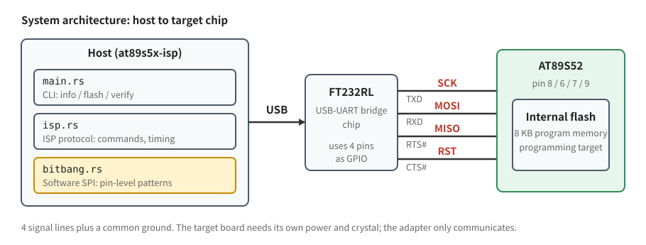
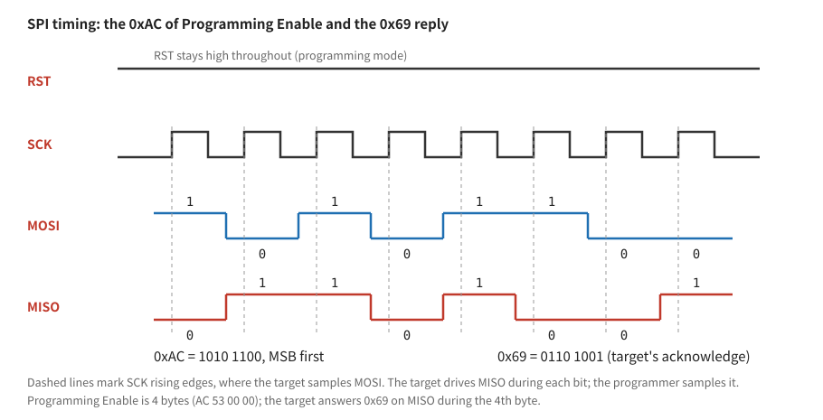
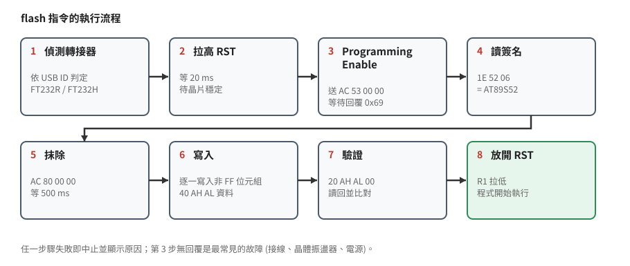
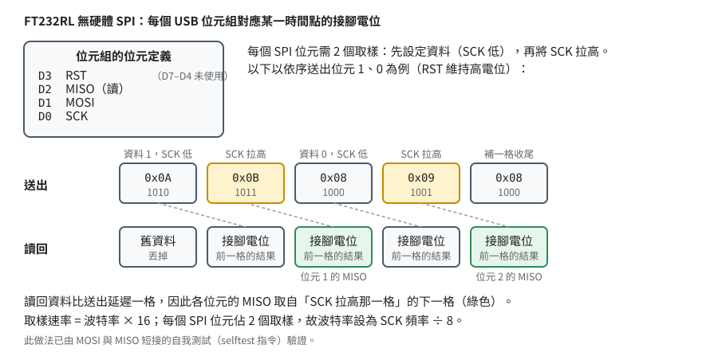

# How It Works

[繁體中文](how-it-works.zh-TW.md)

This document explains how `at89s5x-isp` programs the internal flash of an AT89S51 / AT89S52 through an FT232RL (a USB-to-UART bridge chip): the chip's programming interface, how SPI is implemented in software, performance considerations, and the problems met during development.

No prior knowledge of SPI or the 8051 is required.

## 1. Overview



- Both chips provide a dedicated **ISP (In-System Programming)** interface: SPI-style communication over four signal lines: `SCK` (clock), `MOSI` (host to chip), `MISO` (chip to host) and `RST` (selects programming mode).
- The tool has two layers: `isp.rs` produces the programming commands, and `bitbang.rs` turns them into pin-level changes.

## 2. The Chip's Programming Interface

### 2.1 Entering and Leaving Programming Mode

On the AT89S series, RST is **active high**. The sequence is:

1. Drive RST high. The chip stops running its program and starts accepting SPI commands.
2. Wait about 10 ms for the chip to settle (the tool waits 20 ms).
3. Send the programming commands.
4. Drive RST low. The chip restarts and runs the program that was just written.

The target board needs **R1 (10 kΩ, RST to GND)** so that RST returns to a low level once the adapter releases the pin. Without it the program does not run.

### 2.2 SPI Timing



- **SCK** is the clock. On each rising edge the target samples MOSI once.
- **MOSI** carries the data sent by the host, one bit per clock, most significant bit first.
- **MISO** carries the chip's reply, simultaneously with MOSI. Every byte sent also receives one byte back.

SCK must stay below 1/16 of the chip's clock frequency. With a 12 MHz crystal the limit is 750 kHz. The tool defaults to 100 kHz, which leaves a wide margin.

### 2.3 Instruction Set

Every instruction is exactly 4 bytes. The full definition is in the Serial Programming Instruction Set section of the AT89S51 / AT89S52 datasheets.

| Action | The 4 bytes sent | Reply |
|--------|------------------|-------|
| Programming Enable | `AC 53 00 00` | `69` in byte 4 |
| Read Signature Byte | `28 index 00 00` (index 0, 1, 2) | signature byte in byte 4 |
| Chip Erase | `AC 80 00 00` | wait 500 ms afterwards |
| Read a byte | `20 addr-high addr-low 00` | data in byte 4 |
| Write a byte | `40 addr-high addr-low data` | wait for the write to finish |

The signature identifies the chip: `1E 51 06` is an AT89S51 and `1E 52 06` an AT89S52. The tool uses it to choose the flash size (4 KB / 8 KB).

### 2.4 What `flash` Does



Implementation notes:

- **Only non-`FF` bytes are written.** Erased flash reads `FF`, so blank areas of the HEX file need no writes.
- **Verification reads the flash back and compares.** The first difference aborts the run and reports its address.
- **Only the written range is verified.** After the tool's own chip erase, everything past the last data byte is blank, so it does not need to be read.

## 3. Software SPI on the FT232RL

Higher-end chips such as the FT232H have hardware SPI (MPSSE). The FT232RL does not, so the tool uses its **synchronous bit-bang mode**, which turns the UART pins into plain GPIO that software toggles step by step to generate the clock.



In this mode:

- Each byte the host sends is **the desired state of all pins at one instant**, not data.
- For every byte received, the chip sets the pins accordingly and sends back **the actual state of all pins at that moment**.

Pin assignment:

| Pin | Bit | Role |
|-----|-----|------|
| TXD | D0 | SCK (output) |
| RXD | D1 | MOSI (output) |
| RTS# | D2 | MISO (input) |
| CTS# | D3 | RST (output) |

### 3.1 Producing a Bit

Each SPI bit takes two samples:

1. Set MOSI to the bit value with SCK low (for example `0x0A` when sending a `1`).
2. Keep MOSI and raise SCK (`0x0B`).

A byte therefore takes 16 samples.

### 3.2 When to Sample MISO

The readback **lags the output by one sample**. MISO for the sample where SCK went high must therefore be taken from the **next readback entry**. This is also why every transfer ends with one extra sample.

### 3.3 Setting the Speed

In synchronous mode the sample rate is "baud x 16", and each SPI bit needs two samples, so:

```
baud = SCK frequency / 8
```

For example, a 100 kHz SCK needs a baud rate of 12500.

### 3.4 Verification

Connect `MOSI` to `MISO` with a wire and run `at89s5x-isp selftest`. The bytes sent must come back unchanged, which confirms the timing, the sampling position and the baud setting. No target chip is needed for this test.

## 4. libusb Instead of the Vendor Library

The first version used FTDI's D2XX library, but on Linux it failed with `DEVICE_NOT_FOUND`: the system's `ftdi_sio` driver had already claimed the adapter, so D2XX could not reach it. Working around that meant unloading the driver with `rmmod` after every plug-in.

The FT232R path now uses libusb directly. It detaches `ftdi_sio` for the duration of the run and hands it back afterwards, so no `rmmod` is needed and `/dev/ttyUSB*` keeps working the rest of the time.

The FT232H path still uses D2XX and is untested for lack of hardware.

## 5. Performance

The first version needed 23.6 s to verify 8 KB, because every byte made a full USB round trip costing several milliseconds. Two changes helped:

1. **Batched transfers:** 240 samples are sent before the readback is collected. The FT232R holds 256 bytes of readback, so a batch must not exceed that, or the transfer stalls.
2. **Combined read commands:** verification packs 32 read instructions into one SPI transfer.

Measured results (verifying 8 KB):

| Condition | Time |
|-----------|------|
| Before | 23.6 s |
| Batched, SCK 100 kHz | 11.7 s |
| Batched, `--clock-hz 700000` (practical limit for a 12 MHz crystal) | 2.4 s |

The time is roughly inversely proportional to the SCK frequency. `flash` only reads back the range it wrote, so a small program finishes in under a second.

## 6. Known Problems and Fixes

| Symptom | Cause and fix |
|---------|---------------|
| Programming Enable always failed, checking for `0x53` | The first version used the AVR convention. The AT89S series answers with **`0x69` in byte 4**. Fixed |
| Wrong signature | When reading the signature, the index (0, 1, 2) goes in the **high address byte**. Fixed |
| `DEVICE_NOT_FOUND` | The `ftdi_sio` driver had claimed the device. Switched to libusb (see section 4) |
| `selftest` passes, but with the chip attached every reply is `FF FF FF FF` | The fault was on the target board, not in the software; `selftest` had already shown that the adapter side is correct. Rebuilding only the target's minimal system (power, crystal, reset circuit) fixed it; the adapter wiring was not changed |
| Replies keep changing with the chip attached | MISO is being driven by the chip, but its basic operation is unstable (for example the clock), so the bits are misaligned |

### Diagnostic Commands

These commands help with hardware problems and never touch the flash:

- `selftest`: with no target, short MOSI to MISO to test the adapter.
- `probe`: send Programming Enable continuously and print the reply only when it changes, so the wiring can be adjusted while watching.
- `rst high|low`: hold RST at a fixed level so pin 9 can be measured with a multimeter.

## 7. Limitations

- Verified only on an FT232RL with an AT89S52, on Linux, Windows and macOS. The AT89S51 logic is identical but has not been tested on a real chip.
- Windows needs the WinUSB driver (Zadig) for the adapter. On macOS the system FTDI driver may require `sudo`.
- The FT232H path is untested.
- Lock bits are not handled, only flash contents.
- Other families (AT89LP, AT89S8252 and so on) use different instruction sets. Check the datasheet before assuming support.

## 8. Source Map

| File | Contents |
|------|----------|
| `src/isp.rs` | Programming protocol: instructions, delays, signature detection |
| `src/bitbang.rs` | FT232RL software SPI: turns SPI bits into pin states |
| `src/main.rs` | Command-line interface and output format |
| `src/hexfile.rs` | Intel HEX parsing |

For wiring and installation see the [README](../README.md).
